<p align="center"></p>

<h1 align="center">Boleiro</h1>

<p align="center">Um jogo de técnico de futebol brasileiro para macOS e Windows, no espírito do Brasfoot.</p>

<p align="center"><a href="README.md">English</a> · <b>Português (Brasil)</b></p>

Você treina um clube brasileiro de verdade, com o elenco real, ao longo de uma temporada de estadual, Brasileirão e copas, uma rodada de cada vez, e acompanha todos os jogos da rodada ao vivo numa tela só. Estão no jogo todos os clubes das Séries A a D de 2026 e dos 27 estaduais, as ligas da América do Sul e da Europa que o seu time encontra nas copas continentais, e as seleções. O dinheiro e as chances de cada resultado foram calibrados com números reais: um clube da Série D continua pobre, e o favorito ainda leva uma zebra na copa de vez em quando. Funciona offline e não pede conta. O jogo é todo em português.

<picture>
  <source media="(prefers-color-scheme: dark)" srcset="docs/screens/dark/90-live-round.webp">
  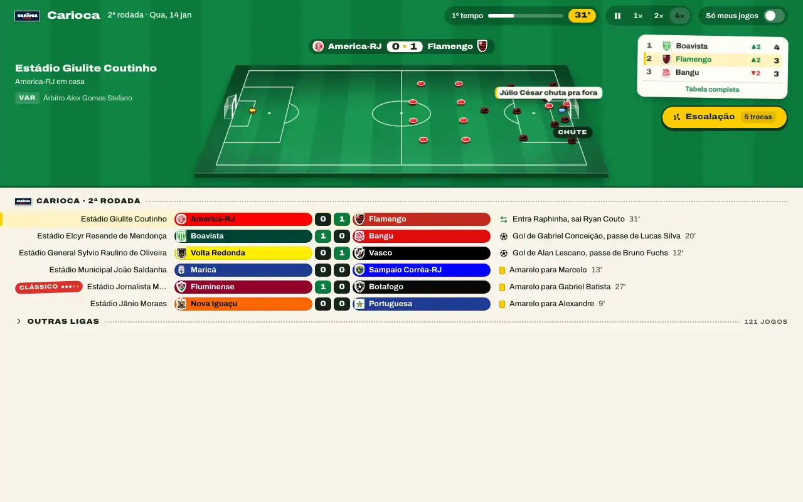
</picture>

## Download

Baixe a versão mais recente na [página de releases](https://github.com/lucasnsaraujo/boleiro/releases/latest):

- **macOS** (Apple Silicon e Intel): `Boleiro_<version>_universal.dmg`. Abra o arquivo e arraste o Boleiro para Aplicativos.
- **Windows** (10 e 11): `Boleiro_<version>_x64-setup.exe`, que instala só para o seu usuário e não pede permissão de administrador, ou o pacote `.msi`, quando a release tiver um.

Os instaladores ainda não têm assinatura de código, então cada sistema mostra um aviso na primeira vez que você abre o jogo:

- **macOS**: o sistema diz que a Apple não pôde verificar o Boleiro. Abra Ajustes do Sistema → Privacidade e Segurança e clique em Abrir Mesmo Assim, ou rode `xattr -dr com.apple.quarantine /Applications/Boleiro.app` no Terminal.
- **Windows**: o SmartScreen mostra "O Windows protegeu o computador". Clique em Mais informações → Executar assim mesmo.

Os jogos salvos ficam numa pasta `saves`, dentro da pasta de dados do app: `~/Library/Application Support/com.lucasnsaraujo.boleiro/` no macOS e `%APPDATA%\com.lucasnsaraujo.boleiro\` no Windows. Desinstalar o jogo não apaga os saves.

## O que tem no jogo

**O mundo do futebol**

- Os 156 clubes das Séries A a D de 2026 e os 125 que só disputam o estadual, com elencos reais (cerca de 6.800 jogadores), estádios, cores, escudos e técnicos. Cada jogador tem uma força de 1 a 99, calculada a partir do valor no Transfermarkt, dos minutos em campo e das notas do Sofascore.
- Os 27 estaduais, as Séries A a D com acesso e rebaixamento, e a Copa do Brasil.
- A primeira divisão dos outros nove países da CONMEBOL; a primeira e a segunda divisão e a copa nacional de 25 países europeus; Arábia Saudita, MLS e Liga MX. Esses clubes se cruzam na Libertadores, na Sul-Americana, na Recopa, na Champions League, na Europa League, na Supercopa da UEFA, no Super Mundial da FIFA (de quatro em quatro anos, a partir de 2029) e no Mundial de Clubes, a Copa Intercontinental que a FIFA disputa todo ano.
- As seleções jogam a Copa do Mundo, as Eliminatórias, a Copa América, a Eurocopa e a Liga das Nações, e nas datas FIFA os seus jogadores são convocados.
- Clássicos, árbitros e patrocinadores de camisa também vêm de fontes reais.

**A sua carreira**

- Comece em qualquer clube do Brasil ou das ligas de fora. A diretoria e a torcida julgam os seus resultados; se perder o apoio delas, você é demitido e fica esperando propostas.
- Clubes do exterior e seleções podem te fazer propostas, e o ranking de técnicos põe você ao lado de todos os outros, junto com o ranking da CBF e o ranking mundial de clubes.
- Até oito técnicos podem jogar no mesmo computador, revezando a vez.
- Escolha como as temporadas são disputadas: Realista segue o calendário real de cada país e os formatos atuais; Rápido põe todas as ligas nas mesmas datas, com grupos de três jogos nas copas e ida e volta só a partir das quartas; e Personalizar deixa você escolher o calendário, turno único ou turno e returno, o formato dos grupos continentais e mata-mata em jogo único ou ida e volta.

**Dia de jogo**

- Monte a escalação e escolha o esquema, depois a postura (de Retranca a Ofensiva), a marcação e se o time joga pelo meio ou pelas pontas.
- Um plano de jogo reage sozinho a um cartão vermelho ou a uma lesão, e você fala com o elenco na preleção e no intervalo.
- A rodada passa ao vivo em 1×, 2× ou 4×: o seu jogo num campinho em cima, todos os outros jogos da rodada embaixo. Faça substituições e mude a tática no meio da partida; checagem do VAR, prorrogação e disputa de pênaltis acontecem ali mesmo.
- Cada partida tem a sua página: resumo, escalações, estatísticas e retrospecto do confronto.

**Gestão do clube**

- O mercado: compra e venda, leilões, empréstimos, multas rescisórias, pré-contratos e renovações, dentro das janelas de transferências.
- Finanças montadas a partir das receitas reais dos clubes, preço do ingresso e ampliação do estádio, categorias de base, propostas de patrocínio, entrosamento do elenco e um capitão, e um auxiliar técnico com leituras e dicas próprias.
- O jornal, as entrevistas coletivas e os acontecimentos do clube que pedem uma decisão sua.
- Uma história que vai se acumulando: títulos, recordes, campeões, artilheiros, a sua carreira, os prêmios da temporada (Bola de Prata e Bola de Ouro) e uma página de álbum para cada temporada.

Temas claro e escuro, som de torcida e música, e F1–F9 para pular entre as telas.

## Telas

<table>
  <tr>
    <td width="50%"><picture><source media="(prefers-color-scheme: dark)" srcset="docs/screens/dark/10-hub.webp">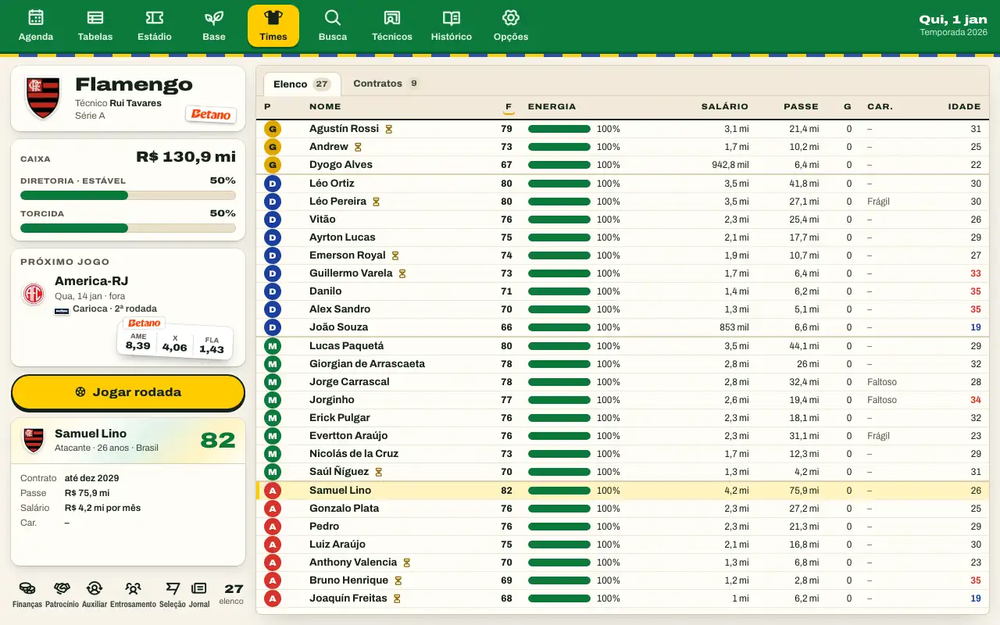</picture><br>A central do clube: elenco, caixa, diretoria e torcida, próximo jogo</td>
    <td width="50%"><picture><source media="(prefers-color-scheme: dark)" srcset="docs/screens/dark/80-lineup.webp">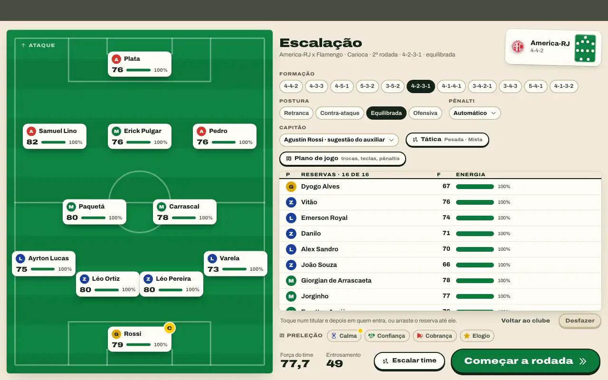</picture><br>Escalação, esquema e tática</td>
  </tr>
  <tr>
    <td><picture><source media="(prefers-color-scheme: dark)" srcset="docs/screens/dark/93-match-page-summary.webp">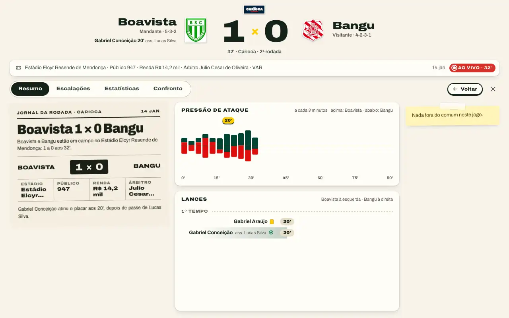</picture><br>A página de uma partida</td>
    <td><picture><source media="(prefers-color-scheme: dark)" srcset="docs/screens/dark/21-market-buy.webp">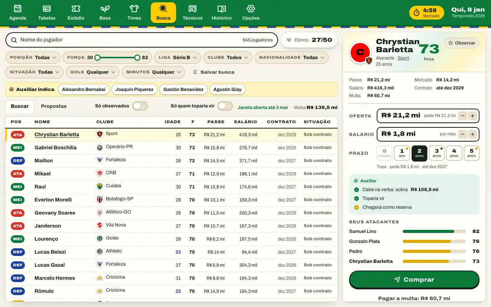</picture><br>Mercado de transferências</td>
  </tr>
  <tr>
    <td><picture><source media="(prefers-color-scheme: dark)" srcset="docs/screens/dark/31-stadium.webp">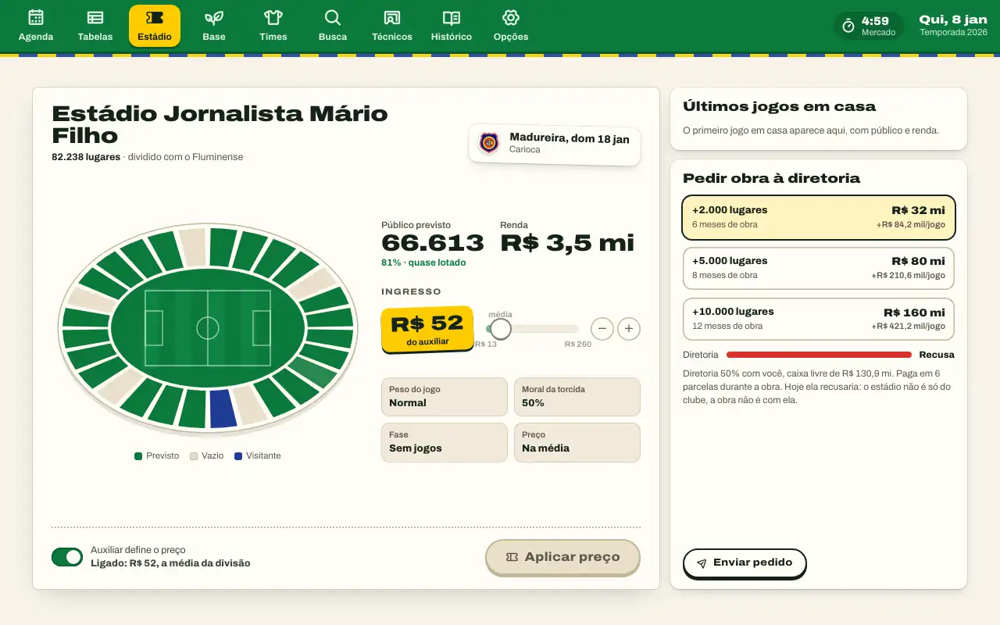</picture><br>Estádio: preço do ingresso e novos lugares</td>
    <td><picture><source media="(prefers-color-scheme: dark)" srcset="docs/screens/dark/33-sponsors.webp">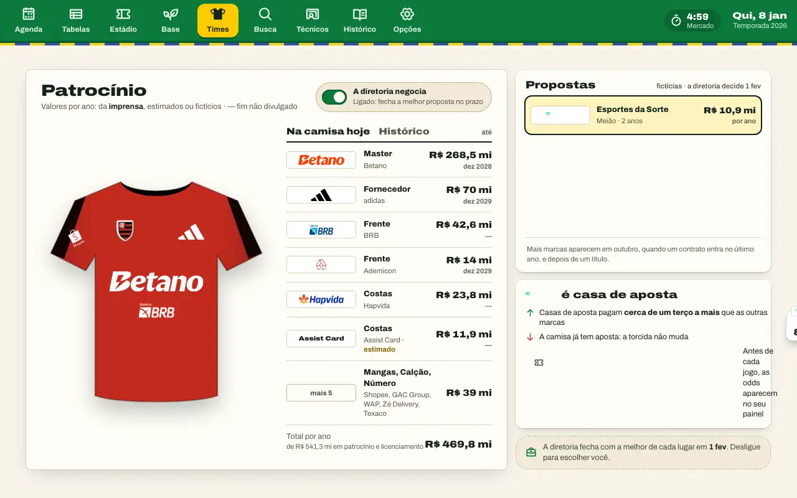</picture><br>Patrocinadores na camisa</td>
  </tr>
  <tr>
    <td><picture><source media="(prefers-color-scheme: dark)" srcset="docs/screens/dark/101-press-conference.webp">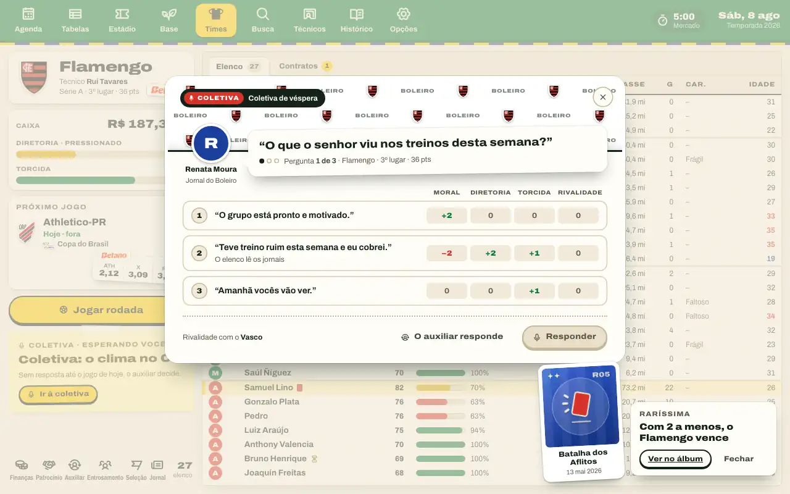</picture><br>Entrevista coletiva</td>
    <td><picture><source media="(prefers-color-scheme: dark)" srcset="docs/screens/dark/36-national-team.webp">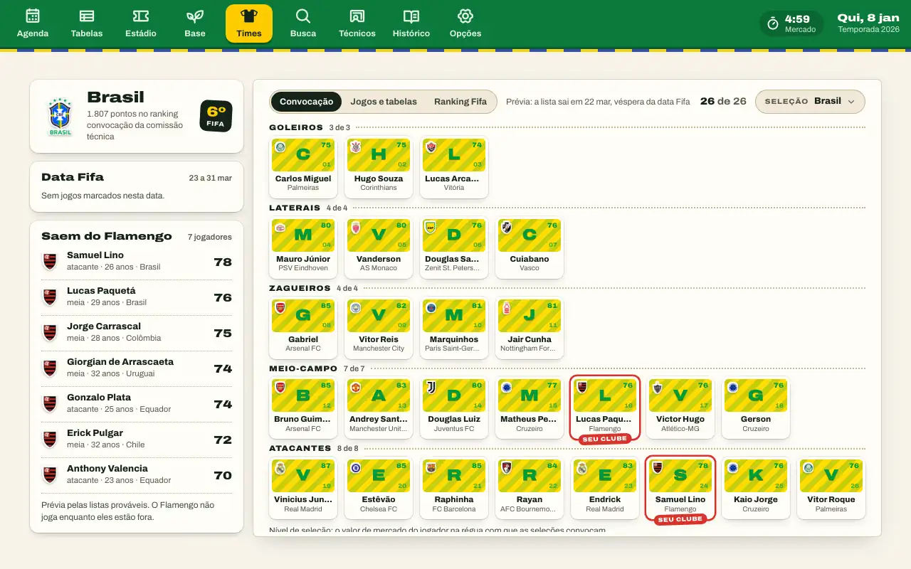</picture><br>Convocação da seleção</td>
  </tr>
  <tr>
    <td><picture><source media="(prefers-color-scheme: dark)" srcset="docs/screens/dark/110-moment-title.webp">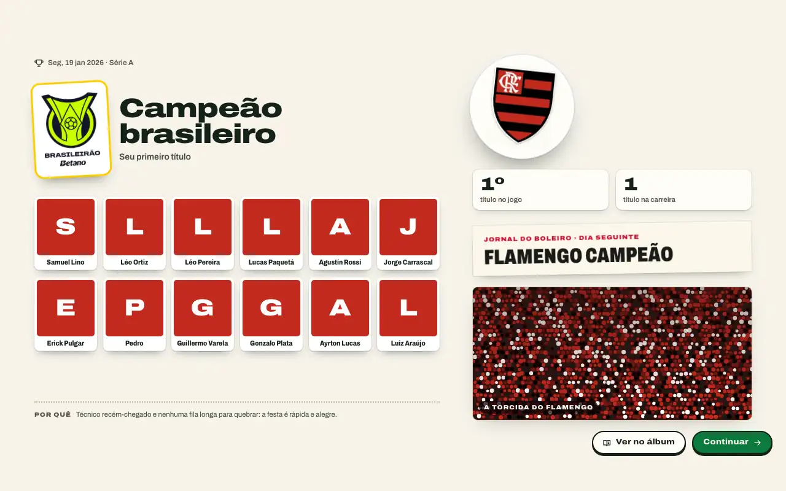</picture><br>Um título conquistado</td>
    <td><picture><source media="(prefers-color-scheme: dark)" srcset="docs/screens/dark/122-awards.webp">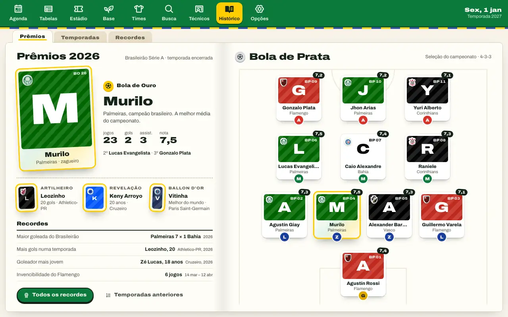</picture><br>Prêmios da temporada</td>
  </tr>
</table>

[Todas as 66 telas, nos dois temas](docs/screens/README.md) (página em inglês).

## Créditos e fontes dos dados

Os dados vêm do Transfermarkt, Sofascore, FotMob, ESPN, football-data.co.uk, Wikipedia e Wikidata, dos balanços publicados pelos clubes e da imprensa. [`data/SOURCES.md`](data/SOURCES.md) diz a fonte de cada valor e quais são estimativas. Os sons vêm do Freesound ([`assets/sounds/CREDITS.md`](assets/sounds/CREDITS.md)); o jogo lista os sons, e todo logo cuja licença pede crédito, em Opções → Créditos.

O Boleiro é um projeto de fã, não oficial. Não tem ligação com nenhum clube, liga, federação ou fonte de dados, nem o apoio deles. Nomes de clubes, escudos, logos de competições e marcas pertencem aos seus donos.

---

O resto desta página é para quem quer mexer no jogo: o código, as ferramentas e o pipeline de dados por trás dele. Os documentos linkados daqui para baixo estão em inglês.

## Desenvolvimento

```sh
pnpm install
pnpm test && pnpm typecheck && pnpm lint
pnpm dev         # o jogo no navegador em http://localhost:5173 (os saves vão para o IndexedDB)
pnpm tauri dev   # o app desktop (precisa de Rust); os saves vão para <app data dir>/saves
pnpm tauri build # o .app e o .dmg do macOS (no Windows: .exe e .msi); docs/release.md explica releases, assinatura e o smoke test no Windows
pnpm e2e         # testes Playwright no build web, na porta 4173 (na primeira vez: pnpm --filter @boleiro/desktop exec playwright install chromium webkit)
                 # reaproveita um servidor que já esteja nessa porta; defina E2E_PORT quando outro checkout estiver com um rodando
                 # o build roda com VITE_E2E=1, que expõe a engine no window para um teste poder pular dias
                 # e começa todo jogo novo pela seed de mundo que o playwright.config.ts define
pnpm calibrate   # reajusta a engine e imprime tabelas real vs. Boleiro por divisão e para confrontos de copa
pnpm test:long   # joga dez temporadas, salvando e carregando cada uma, e confere se receita, força, transferências, resultados das Séries B–D e distribuição dos elencos ficam dentro das faixas; o CI pula esse teste, então rode depois de mexer em força de jogador, dinheiro ou mercado
pnpm finances:report [seasons] [seed]   # imprime as faixas de receita por divisão de uma simulação longa
pnpm strength:report [seasons] [seed]   # imprime as faixas de força dos jogadores e a idade média por divisão a cada temporada
pnpm career [--seasons N] [--seed S]    # modo carreira com um técnico automático: clubes, metas, resultados e demissões por divisão
pnpm history [--seasons N] [--seed S] [--club ID]   # a mesma carreira, depois os títulos, campanhas, recordes e ídolos de um clube e o retrospecto do técnico
pnpm season [--seasons N] [--seed S] [--club ID] [--report]   # temporadas inteiras sem técnico, depois o relatório de realismo
pnpm world:rates [--leagues N] [--seed S]   # ligas sintéticas jogadas completas e só pelo resultado; falha se os gols por jogo diferirem em 0,1 ou a taxa de vitória do mandante, de empate ou de vitória do visitante em 2 pontos, a tolerância de calibração da engine
```

`pnpm calibration:report` e `pnpm perf:report` geram [`docs/calibration-report.md`](docs/calibration-report.md) (o jogo ainda se comporta como as ligas reais?) e [`docs/performance.md`](docs/performance.md) (tempo de uma temporada, tamanho do save, memória); cada arquivo explica como rodar de novo. [`docs/release.md`](docs/release.md) cobre o build dos instaladores, o workflow de release e a assinatura, e [`docs/screens/`](docs/screens/README.md), como gerar as capturas de tela de novo.

O repositório é um workspace do pnpm. Os pacotes têm código TypeScript sem etapa de build: cada `package.json` mapeia `@boleiro/<name>/<path>` para `src/<path>.ts`.

| Pasta | Pacote | O que tem |
|---|---|---|
| `packages/data/` | `@boleiro/data` | O data pack e o manifesto de assets que o jogo distribui (`pack/`) e os loaders deles, além dos parsers dos arquivos em `data/` (clubes, jogadores, finanças, histórico) |
| `packages/engine/` | `@boleiro/engine` | A simulação: a engine de partidas (`src/engine/`), as temporadas e o mundo dos clubes (`src/sim/`), as execuções de CLI (`src/cli/`) |
| `packages/game-client/` | `@boleiro/game-client` | A sessão da engine e o Web Worker dela, os saves e os seletores que as telas leem do estado do jogo; sem React |
| `packages/design-tokens/` | `@boleiro/design-tokens` | O design system Álbum, que o app e os mocks compartilham: tokens claros e escuros (`album.css`, `tokens.json`), a fonte Archivo e os ícones Phosphor vendorizados (reduzidos por `pipeline/subset_icons.py` aos que as telas usam), e `tokens.css`, os nomes antigos de tokens apontando para os do Álbum |
| `apps/desktop/` | `@boleiro/desktop` | O app: telas em `ui/` (Vite + React), a janela desktop e os arquivos de save em `src-tauri/`, testes Playwright em `e2e/` |
| `design/` | nenhum | O logo do Boleiro (`logo/`) e um mock em HTML de cada tela, com renders (`mocks/`, abra `mocks/index.html`) |

As dependências vão num sentido só: `data` ← `engine` ← `game-client` ← `desktop`. A simulação não sabe nada da UI: ela roda num Web Worker (`packages/game-client/src/engine/engine.worker.ts`) e as telas falam com ela pelo `EngineClient`, em `packages/game-client/src/engine/connectEngine.ts`. Toda ação do jogador é um `GameCommand` (`packages/game-client/src/engine/createEngineSession.ts`), um objeto JSON simples como `{ type: "ask", request }`; `engine.apply(command)` é a única chamada que altera o jogo, e o resto do `EngineClient` só lê. Os mesmos comandos aplicados a partir da mesma seed reconstroem o mesmo jogo, no Node e em qualquer motor de navegador, então o modo online pode, mais para frente, mandar esses comandos pela rede, e um save levado para outra máquina continua do mesmo jeito. Os motores arredondam `Math.exp`, `Math.log`, `Math.pow` (e `**`) e as funções trigonométricas de um jeito diferente no último bit, então a simulação chama as cópias em `packages/engine/src/sim/portableMath.ts`, que dão os mesmos bits do Node 22 em x86-64 em qualquer lugar; o ESLint barra as versões nativas do motor em `engine` e `game-client`, e `apps/desktop/e2e/crossEngine.spec.ts` confere que Node, Chromium e WebKit salvam o mesmo jogo todo dia. O ESLint impede `engine` e `data` de importar React, Tauri ou os pacotes de UI, impede `data` de importar qualquer outro pacote do Boleiro, impede `game-client` de importar React e impede tudo que está fora da sessão do worker de importar `advanceDay`. No navegador, o worker monta jogos novos a partir do mesmo data pack que o Node lê, empacotado pelo Vite (`newGameFromFiles` em `packages/engine/src/sim/loadNewGame.ts`). Os arquivos brutos ficam na raiz do repositório, em `data/` e `assets/`, como entrada do pipeline.

O `pnpm season` imprime, para cada temporada, as classificações finais (Séries A e B com pontos, o topo da C e da D), os campeões da Copa do Brasil e dos estaduais, quem subiu e quem caiu, as cinco maiores transferências, as faixas de receita por divisão e os clubes com mais e menos dinheiro em caixa. Depois imprime a história de um clube (`--club`, por padrão o último campeão da Série A) e um relatório de realismo: tabelas em markdown que comparam resultados, zebras na Copa do Brasil por diferença de divisão, cartões, receita, estrangeiros e lesões com os dados reais em que a simulação se baseia. `--report` imprime só o relatório de realismo. A suíte de testes padrão joga duas temporadas dele, salvando e carregando o jogo no começo de cada uma.

## Dados

### Clubes, jogadores e escudos

`data/clubs.csv` lista todos os clubes das Séries A–D de 2026 e todos os que só disputam o estadual de 2026: estádio, capacidade, gramado, cores e torcida. `data/crests.csv` liga cada clube às imagens do seu escudo em `assets/crests/`. `data/players.csv` tem todos os elencos, com uma força calculada de 1 a 99, ligados ao clube por `club_id`. `data/SOURCES.md` diz a fonte de cada valor derivado. Para reconstruir os dois:

```sh
python3 -m venv .venv && .venv/bin/pip install -r pipeline/requirements.txt
.venv/bin/python pipeline/scrape_tm.py data/transfermarkt-players.csv   # elencos e valores de mercado (Transfermarkt), com cache em data/tm_cache
pipeline/fetch_sofascore.sh data/sofascore-stats.json                     # estatísticas da temporada (Sofascore), precisa do agent-browser
.venv/bin/python pipeline/fetch_wiki_colours.py data/transfermarkt-players.csv data/wiki-colours.csv   # cores do uniforme (Wikidata + pt.wikipedia)
.venv/bin/python pipeline/build_clubs.py data/club-facts.csv data/wiki-colours.csv data/clubs.csv
.venv/bin/python pipeline/fetch_crests.py   # escudos em assets/crests/ e data/crests.csv (Transfermarkt + ESPN), precisa do oxipng
.venv/bin/python pipeline/rate_players.py data/transfermarkt-players.csv data/sofascore-stats.json data/clubs.csv data/players.csv
.venv/bin/python pipeline/fetch_sponsors.py      # fornecedores de material e patrocinadores de camisa (Wikipedia, de antes da proibição das bets) em data/sponsors.csv
.venv/bin/python pipeline/fetch_brand_logos.py   # data/brands.csv e os logos em assets/logos/ (Wikidata, Commons, favicons)
```

### Patrocinadores

`data/sponsors.csv` tem todas as marcas no uniforme 2026 de cada clube como a Wikipedia listava antes da proibição das bets no Brasil (25 de setembro de 2026), `data/sponsor-values.csv` os valores anuais e os fins de contrato que a imprensa publicou, `data/brand-pool.csv` as marcas que fazem propostas de patrocínio no jogo e `data/brands.csv` todas as marcas com o seu logo. A seção "Sponsors" de `data/SOURCES.md` diz de onde vem cada uma e como o jogo preenche o que falta nas fontes.

### Posições, escalações e técnicos

As posições e as últimas escalações vêm do FotMob: `.venv/bin/python pipeline/scrape_fotmob.py data` (com cache em `data/fotmob_cache`, usando o mesmo fetcher do scraper do Transfermarkt, que respeita os limites do site) gera `data/fotmob-players.csv` (as posições de cada jogador no FotMob, ligadas ao id dele no Transfermarkt pelo nome dentro do clube) e `data/fotmob-lineups.csv` (o último time titular de cada clube, com o esquema quando o FotMob informa; os jogos das Séries C e D listam só os titulares). A posição principal de um jogador continua sendo a do Transfermarkt; o FotMob acrescenta as outras. No jogo, um jogador rende toda a sua força na posição principal, 97% em outra posição dele e 85% em qualquer outra (50% para goleiro na linha ou jogador de linha no gol); cada clube joga no seu último esquema real ou, se não houver, no que melhor encaixa no seu time titular real ou, por fim, no seu elenco.

O técnico de cada clube vem das listas de treinadores por liga do Transfermarkt: `python3 pipeline/fetch_coaches.py` (com cache em `data/tm_cache`; `--offline` reconstrói a partir dele) gera `data/coaches.csv` e a lista de técnicos da engine, `packages/data/src/coachRoster.ts`; os clubes que essas listas não cobrem ganham técnicos locais inventados.

### Dados conferidos à mão e força

`data/club-facts.csv` tem valores conferidos à mão (gramados sintéticos, fatias de torcida das pesquisas, nomes curtos) que substituem ou completam os coletados.

A força parte de uma base por divisão e se move conforme os números de cada jogador: valor de mercado, fatia de minutos jogados, nota no Sofascore e, para atacantes, gols e assistências por 90 minutos. Jogadores com poucos dados ficam perto da base.

### Resultados históricos

`data/history/brasileirao-serie-a-odds.csv` tem os resultados da Série A desde 2012 com as odds de fechamento das casas de apostas, do football-data.co.uk. A engine de partidas é calibrada com esses dados, com os resultados das Séries B–D abaixo e com jogos da Copa do Brasil entre clubes de divisões diferentes.

O resto de `data/history/` tem resultados da Copa do Brasil e das Séries B–D de duas fontes, uma pasta para cada, com as mesmas colunas:

- `sofascore/`: só 2024, a temporada baixada antes de o captcha do Cloudflare no Sofascore nos bloquear. É a única fonte com a Série D, e as linhas da copa têm odds 1X2 de fechamento (119 de 122). As linhas das Séries B–D não têm odds: o Sofascore entrega uma requisição por jogo e bloqueia rápido quem pede demais, e para calibrar o mando de campo e os gols por jogo bastam os resultados.
- `espn/`: todas as outras temporadas, da API pública da ESPN: 2015–2026 para a copa e a Série B, 2017–2025 para a Série C (a ESPN não tem nada antes disso). Sem odds e sem Série D.
- `divisions.csv` em cada pasta: a divisão de cada time em cada temporada, tirada da classificação daquela temporada, para um confronto de copa poder ser marcado como "A vs D". A ESPN só conhece A–C, então, nas temporadas da ESPN, um time de copa sem divisão é da Série D ou de baixo dela.

Cada arquivo tem uma linha por jogo encerrado: data, rodada, ids e nomes dos times na fonte, uma `*_key` normalizada para cruzar as fontes, o placar sem a disputa de pênaltis, o vencedor nos pênaltis (`home`/`away`) e as colunas de odds. As odds da Série A vêm do football-data.co.uk (acima). 2026 só tem os jogos já encerrados na data da coleta.

`packages/data/src/history.ts` carrega esses arquivos (`loadResults`, `loadDivisions`); uma temporada que as duas fontes cobrem vem do Sofascore. Para reconstruir:

```sh
.venv/bin/python pipeline/fetch_espn.py       # HTTP simples; guarda as respostas brutas em cache em data/history_cache/espn
.venv/bin/python pipeline/fetch_history.py    # Sofascore, precisa do agent-browser; cache em data/history_cache
```

O Sofascore mostra um captcha do Cloudflare quando recebe requisições rápido demais, então o `fetch_history.py` baixa uma URL por vez com uma pausa, retoma do cache quando roda de novo e para com uma mensagem quando o captcha aparece (espere de 15 a 30 minutos e rode de novo). Apague um arquivo do cache para baixá-lo outra vez.

### Banco mestre e data pack

O jogo não lê `data/` nem `assets/` diretamente. O pipeline carrega esses arquivos num banco mestre SQLite, um snapshot por execução, e monta o **data pack** que o app distribui a partir do snapshot mais recente da importação dos CSVs:

```sh
python3 pipeline/import_csv.py data pipeline/boleiro.db                          # um snapshot novo no banco mestre (ignorado pelo git)
python3 pipeline/build_pack.py pipeline/boleiro.db packages/data/pack             # brazil.pack.json.gz e sponsors.pack.json.gz
.venv/bin/python pipeline/build_assets.py pipeline/boleiro.db packages/data/pack  # assets/ e assets.json, precisa do Pillow (e de data/tm_cache para world/)
```

- `pipeline/schema.sql` é o banco: países, competições, clubes, estádios, jogadores com as posições em ordem (a principal do Transfermarkt no rank 0, as do FotMob depois), as últimas escalações dos clubes (`club_lineups`), valores e contratos, finanças com o documento e a página por trás de cada número (`finance_sources`, de `data/finance-sources.csv`), premiações, marcas e contratos de patrocínio (`brands`, `sponsor_deals`), imagens, a fonte de cada valor e os ids de cada fonte para um clube ou jogador. Toda linha carrega o seu `snapshot_id`, e clubes e jogadores mantêm o mesmo id entre snapshots, então duas execuções se comparam com um join. Faça o backup dele como asset de uma GitHub Release, não no git. O schema ainda não tem migrations: `CREATE TABLE IF NOT EXISTS` deixa as tabelas de um banco existente como estavam, então, depois de mudar o `schema.sql`, apague `pipeline/boleiro.db` e importe de novo.
- `packages/data/pack/brazil.pack.json.gz` é um único documento JSON com uma coluna por campo (`clubs.name[i]` é o nome do clube i), compactado com gzip. `packVersion` é um hash do conteúdo. Um jogo novo guarda esse valor no save (`GameState.packVersion`), então uma carreira mantém o pack com que começou; um save de antes dos packs é lido como `FIRST_PACK_VERSION`, o pack montado a partir dos CSVs do Brasil de 2026, que continua com esse valor quando saem packs mais novos. A coluna `players.positions` guarda as funções de cada jogador, a principal primeiro, e `lineups` guarda o último time titular de cada clube; um save de antes das posições recebe as duas coisas do pack distribuído quando é carregado (`withPackPositions`). `packages/data/src/dataPack.ts` decodifica o pack: `loadPack()` no Node, `parsePack` no texto que o Vite empacota via `gunzipImports` (imports `?gunzip`).
- `packages/data/pack/assets/` guarda cada imagem numa pasta por tipo (`crest/`, `scoreboard_crest/`), sem duplicatas dentro do tipo graças ao hash do conteúdo no nome, em WebP ajustado a caixas de 64, 128 e 256 px (nunca ampliado). `assets.json` lista as imagens e qual clube usa qual. O app escolhe a caixa que preenche o tamanho de cada escudo, e o dobro disso em telas de alta densidade. `pack/world/assets/` e `pack/world/assets.json`, com a mesma estrutura, guardam os escudos dos clubes da coleta mais recente do mundo que a importação dos CSVs não tem, só em WebP e só nas caixas de 64 e 128 px (esses clubes aparecem em resultados, classificações e chaves, nunca em tamanho grande; uma tela que pede 256 recebe o arquivo de 128), para que as imagens do mundo da v1 caibam nos ~25 MB da SPEC (14,8 MB ao todo hoje, contando os logos dos patrocinadores, os escudos das seleções e os logos das competições, limite que o `assetBudget.test.ts` cobra). `pack/national/` guarda os escudos das seleções do mesmo jeito, numa paleta de 128 cores sem perdas quando ela mantém a cara do escudo (`pipeline/fetch_national_crests.py`). `pack/competitions/` guarda os logos reais das competições do mesmo jeito, por competição ou por edição em `competitions` (`pipeline/fetch_competition_logos.py`, `data/competition-logos.csv`); uma competição sem logo ganha um desenhado pelo app.
- `packages/data/pack/sponsors.pack.json.gz` guarda as marcas e os contratos de patrocínio num pack próprio (`packages/data/src/sponsors.ts`), para que o pack do Brasil e o seu `packVersion` não mudem quando muda um patrocinador. Um jogo novo copia para o save os contratos de cada clube e o grupo de ofertas; um save de antes dos patrocínios recebe esses dados do pack distribuído quando é carregado. Os logos ficam em `pack/sponsors/assets/` e `pack/sponsors/assets.json` (de marca para logo), só em WebP, nas caixas de 64, 128 e 256 px (a caixa que um logo é pequeno demais para preencher fica de fora), a maioria numa paleta de 64 cores guardada sem perdas; um logo sobre um fundo opaco (um ícone de site) é um `badge`, que a camisa mostra como um patch costurado em vez de estampar na tinta do uniforme. Todo logo cuja licença pede crédito (qualquer uma que não seja domínio público, CC0, uso livre com copyright ou a licença desconhecida de um favicon) está listado em `packages/data/src/logoCredits.ts`, que o `fetch_brand_logos.py` gera (`--credits` sozinho reescreve o arquivo a partir de `data/brands.csv`) e que a tela de Opções mostra junto dos créditos dos sons.
- `pnpm test` monta um pack a partir de `data/` numa pasta temporária e confere que ele decodifica exatamente no que os parsers de CSV dão, que o pack commitado é esse mesmo pack e que cada classe de asset fica dentro do seu orçamento de bytes (`packages/data/src/assetBudget.test.ts`): o tamanho de hoje mais uns 25%. Quando os dados do mundo chegarem, aumente um orçamento de propósito, no mesmo commit.

### Elencos do mundo (Transfermarkt)

`pipeline/tm_world.py` lista o mundo da v1 (SPEC §6): as Séries A–D do Brasil, a primeira divisão dos outros nove países da CONMEBOL (e a segunda da Argentina), a primeira e a segunda divisão e a copa nacional de todo país europeu no sorteio da Champions ou da Europa League de 2026/27, Arábia Saudita, MLS e México, os outros clubes do Super Mundial e as seleções da Copa do Mundo de 2026 e das Eliminatórias sul-americanas e europeias. O `scrape_world.py` grava tudo num único snapshot `transfermarkt` do banco mestre (uma execução com `--countries`, `--no-guests` ou `--no-national-teams` grava um `transfermarkt-partial`, que os packs, o build de assets e o diff de elencos ignoram quando procuram o mundo mais recente): elencos com a posição do Transfermarkt convertida numa função (goleiro, lateral, zagueiro, meia, atacante, em `pipeline/positions.py`), as cores da página de dados de cada clube, os escudos com a URL de origem e a fonte de cada valor do clube (`guess` ou `missing` quando o Transfermarkt não tem). Os jogadores ainda não ganham força.

```sh
.venv/bin/python pipeline/scrape_world.py pipeline/boleiro.db [--countries br,gb-eng] [--delay 3]   # páginas em cache em data/tm_cache
.venv/bin/python pipeline/build_world_packs.py pipeline/boleiro.db packages/data/pack/world   # <country>.pack.json.gz + national-teams.pack.json.gz
python3 pipeline/roster_diff.py pipeline/boleiro.db                               # quem foi para onde entre as duas últimas coletas completas, em Markdown
.venv/bin/python -m unittest discover -s pipeline/tests -t pipeline              # os testes do pipeline, em páginas salvas em pipeline/tests/fixtures
```

O scraper se identifica no User-Agent, mas sem citar nenhuma pessoa ou conta; espera `--delay` segundos depois de cada página (nunca menos que os 2 que o robots.txt do Transfermarkt pede); tenta de novo em erros 429 e de servidor, com uma espera que vai crescendo ou com o Retry-After que o site manda; interrompe a execução depois de 10 recusas (403 ou 429) seguidas; e guarda toda página no cache, então uma execução interrompida retoma de onde parou e uma nova execução dentro de `--max-age-days` não baixa nada. Cada clube custa uma página de elenco, uma página de dados e uma imagem de escudo. `--offline` reconstrói o snapshot só com o cache e falha numa página que não está lá em vez de baixá-la. Os clubes do Brasil mantêm os ids de `data/clubs.csv`; os outros clubes são `tm-<Transfermarkt id>`, e os jogadores também, `tm-<Transfermarkt id>`.

Um jogo novo no app carrega os packs dos outros nove países da CONMEBOL (`packages/game-client/src/engine/bundledGameFiles.ts`, lidos por `packages/data/src/worldPack.ts`): as ligas deles são simuladas só pelo resultado (`packages/engine/src/sim/world/southAmerica.ts`) e os clubes enfrentam os brasileiros na Libertadores, na Sul-Americana e na Recopa (`packages/engine/src/sim/continental/`). Os jogadores ganham força pelo valor no Transfermarkt, seguindo a reta que as notas dos próprios jogadores brasileiros formam contra os valores deles (`strengthYardstick.ts`). O app também carrega os packs dos 25 países europeus: primeira e segunda divisão e uma copa nacional em cada um, simuladas só pelo resultado de agosto a maio (`packages/engine/src/sim/world/europe.ts`, com a Noruega no ano civil), e a Champions League, a Europa League e a Supercopa da UEFA (`packages/engine/src/sim/continental/uefaCups.ts`), que começam pelas fases de liga reais de 2026/27 e, a partir de 2027/28, tiram as vagas de cada país da sua tabela e da sua copa, pela distribuição de 2026/27. Um país simulado só pelo resultado passa para o nível completo quando um técnico humano assume um dos seus clubes, no começo do jogo ou por uma proposta de emprego: os clubes passam a ter salários, dinheiro e diretoria, e as ligas passam a ser jogadas minuto a minuto, como as do Brasil (`packages/engine/src/sim/world/joinFullTier.ts`). As execuções no Node (`loadNewGame`, a CLI e os testes da engine) ficam só com o Brasil, a não ser que passem `world: [...loadSouthAmerica(2026), ...loadEurope(2026)]`. O app carrega ainda os packs da Arábia Saudita, dos EUA e do México, cujas primeiras divisões um técnico pode assumir (MLS e Liga MX nos formatos reais, `packages/engine/src/sim/leagueFormats.ts`), e os dos convidados do Mundial de Clubes da FIFA, usados nesse torneio, que o jogo chama de Super Mundial e disputa em 2029 e de quatro em quatro anos depois disso (`packages/engine/src/sim/continental/clubWorldCup.ts`), e na Copa Intercontinental anual da FIFA, com os campeões das seis confederações em setembro, outubro e dezembro (`packages/engine/src/sim/continental/intercontinentalCup.ts`), que o jogo chama de Mundial de Clubes. `packages/data/src/worldPacks.test.ts` confere os packs commitados: todo país de `tm_world.py` tem um pack e cada liga tem o número de clubes que `tm_world.py` registra para ela (o número que a página da liga no Transfermarkt lista; `verified=False` marca as que nenhuma segunda fonte confirmou ainda); todo clube tem pelo menos onze jogadores, com um goleiro (menos os poucos que o Transfermarkt lista incompletos, nomeados no teste), um escudo em `assets.json` ou `world/assets.json`, com os arquivos de todo escudo do mundo dentro do orçamento, duas cores e uma fonte para cada campo; as divisões de todo país vão da primeira para baixo; toda seleção tem um elenco com goleiro.
